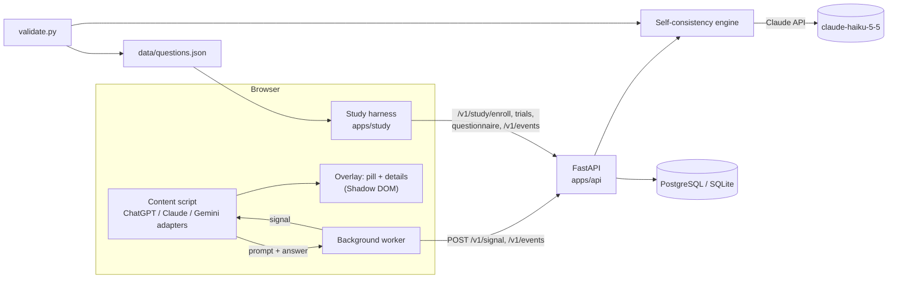
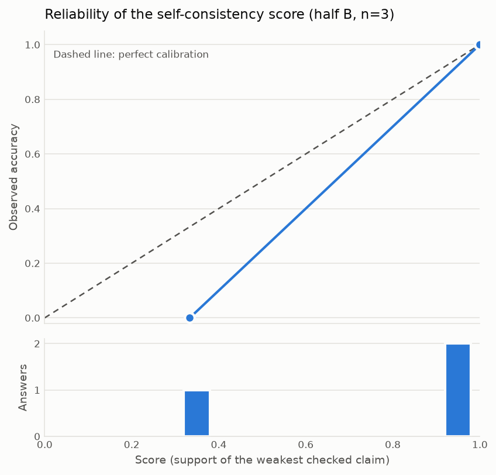

# CalibrAI

CalibrAI is a research prototype for **trust calibration signals**: short, honest cues shown under an
AI assistant's answer that help people judge when to rely on it and when to check. It has three
parts:

- a **Chrome extension** that adds a confidence signal under answers on ChatGPT, Claude and Gemini;
- a **FastAPI backend** whose self-consistency engine produces that signal by checking whether
  independent answers to the same question agree with the answer's claims;
- a **study harness** for a controlled experiment on whether such signals improve people's
  accept/reject decisions.

It is not a fact checker. The signal measures agreement, and agreement can be wrong (see
[Limitations](#limitations)).

## Architecture



- **Extension** (repo root: `src/`, `entrypoints/`, `wxt.config.ts`; WXT, React, Manifest V3). Site
  adapters find finished answers; the background worker is the only part that talks to the network.
  The overlay is a collapsed pill (icon, level, reason such as "4/5 checks agree") that expands into
  the checked claims, weakest first. Mock mode needs no backend.
- **Backend** (`apps/api`; FastAPI, SQLAlchemy, Alembic). Session tokens, consent, signals, events
  and the study endpoints. The **self-consistency engine** extracts up to 8 checkable claims from the
  answer (each grounded in the answer's own words), samples 5 independent answers to the same prompt,
  and has one judge call mark every claim as supported, contradicted or not mentioned in each
  sample. The level comes from the weakest claim that at least 2 samples address: high at 0.80 or
  more, medium at 0.60 or more, otherwise low. Refusals and code-only answers abstain.
- **Study harness** (`apps/study`; Vite, React). A static site that runs the experiment against the
  study endpoints. It reuses the extension's overlay and colour tokens through a path alias.
- **Validation** (`apps/api/scripts/validate.py`). Runs the engine on 100 public questions, labels the
  answers, computes ranking and calibration metrics, and builds the study set.

## Running locally

Prerequisites: Node.js 20+ with Corepack (pnpm 9 is pinned), Python 3.14 (tests run on 3.14.5), and
an Anthropic API key for real signals. Commands are for PowerShell from the repository root.

```powershell
corepack pnpm install
python -m pip install -r apps\api\requirements.txt
```

### API

```powershell
Set-Location apps\api
Copy-Item .env.example .env
# In .env: set LLM_API_KEY=<your key> and CALIBRAI_SIGNAL_PROVIDER=selfconsistency for real signals
# (the default provider, mock, returns a fixed demo signal). Never commit .env.
python -m alembic upgrade head
python -m uvicorn app.main:app --host 127.0.0.1 --port 8000
```

Check one answer without the extension (a second terminal, in `apps\api`, so `.env` is read):

```powershell
python scripts\try_signal.py --prompt "When was the Eiffel Tower completed?" --answer "It was completed in 1902 for the Paris World Fair."
```

### Extension

```powershell
npx wxt build --mode development     # -> .output\chrome-mv3-dev; allows the local API
```

In `chrome://extensions`, turn on Developer mode, **Load unpacked** and pick `.output\chrome-mv3-dev`.
It starts in mock mode. For real signals, create a participant and session token against the local
API and paste both into the extension's options page (right-click the icon > Options, mode
"Authenticated API"):

```powershell
$api = 'http://127.0.0.1:8000'
$secret = '<CALIBRAI_ENROLLMENT_SECRET from apps\api\.env>'
$participant = [guid]::NewGuid().ToString()
$session = Invoke-RestMethod -Method Post "$api/v1/session" -ContentType 'application/json' `
  -Body (@{ participant_id = $participant; enrollment_secret = $secret } | ConvertTo-Json)
Invoke-RestMethod -Method Post "$api/v1/consent" -ContentType 'application/json' `
  -Headers @{ Authorization = "Bearer $($session.access_token)" } `
  -Body (@{ participant_id = $participant; consent_version = '2026-11-04'; status = 'granted' } | ConvertTo-Json)
$participant; $session.access_token
```

Reload any open ChatGPT, Claude or Gemini tab after loading the extension. `corepack pnpm dev`
starts WXT's development browser instead, and `/overlay-preview.html` in a development build shows
every overlay state in light and dark.

### Study harness

```powershell
# API terminal, in apps\api: set these before starting uvicorn (they override .env)
$env:CALIBRAI_STUDY_ENROLLMENT_CODE = 'local-study-code'
$env:CALIBRAI_STUDY_ORIGINS = 'http://localhost:5174'
python -m uvicorn app.main:app --host 127.0.0.1 --port 8000

# Harness terminal, from the repository root
Set-Location apps\study
npm run dev          # open http://localhost:5174/?code=local-study-code
npm run demo         # no backend, nothing saved; add ?condition=A, C or baseline to pick one
```

The flow is consent, demographics, 2 practice trials, 30 main trials, a 5-item questionnaire and a
debrief. Export what was recorded with `python apps\api\scripts\export_study.py`
(CSV files in the git-ignored `apps\api\exports\`).

### Validation

```powershell
python apps\api\scripts\validate.py --resume        # run or continue (calls the LLM; the report lists the cost)
python apps\api\scripts\validate.py --report-only   # recompute the report without LLM calls
python apps\api\scripts\readme_validation.py        # copy the new numbers into this README
```

### Tests and builds

```powershell
npx vitest run; npx tsc --noEmit; npx wxt build                        # extension
python -m pytest apps\api\tests -q --basetemp <a writable folder>      # backend
Set-Location apps\study; npm test; npm run build                       # harness
```

Deployment (Render, Vercel, the extension ID and CORS) is in [docs/DEPLOY.md](docs/DEPLOY.md); the
manual end-to-end check is [docs/SMOKE_TEST.md](docs/SMOKE_TEST.md).

## Validation results

The engine was run on 100 questions: 60 from NQ-open and 40 from SimpleQA, answered by
`claude-haiku-5-5`. Answers were labelled against the gold answers, metrics were computed on a
seeded held-out half, and 4 labels that look wrong are listed for human review. Both columns are
shown: all items, and the review items excluded.

<!-- validation:start: generated by apps/api/scripts/readme_validation.py from data/validation/report.md; do not edit by hand -->
From [`data/validation/report.md`](data/validation/report.md) (generated 2026-11-24T21:28+00:00 by `apps/api/scripts/validate.py`)

- Questions evaluated: **100 of 100**
- Signal versions: `selfconsistency-v2:claude-haiku-5-5` (100)
- Labels: {'correct': 45, 'incorrect': 31, 'not_attempted': 24}; label source: {'exact': 35, 'judge': 65}

| Metric | All items | Review items excluded |
|---|---|---|
| Usable answers (half A / half B) | 71 (36 / 35) | 67 (35 / 32) |
| AUROC, 95% bootstrap CI (half B) | 0.82 (95% CI 0.69-0.94) | 0.83 (95% CI 0.68-0.95) |
| ECE, 10 bins (half B) | 0.305 | 0.254 |
| Brier (half B) | 0.248 | 0.202 |
| High accuracy, all evaluated answers | 0.76 (42/55) | 0.81 (42/52) |

- Signal latency: p50 3.8 s, p95 7.0 s (measured with 4 questions in flight).
- Signal cost per answer: $0.0010 (mean; first-party API prices).

The report's own reading of these numbers:

> 1. **The score ranks answers well but is poorly calibrated.** On half B, AUROC is 0.82 (95% CI 0.69-0.94), but ECE is 0.31. The score is overconfident: 22 of 35 held-out answers scored 1.00, but only 17 of them (77%) were correct. An answer the model gives the same way every time looks consistent even when it is wrong; this is a known limitation of self-consistency. Without the 4 review items: AUROC 0.83 (95% CI 0.68-0.95), ECE 0.25.
> 2. **Isotonic calibration lowers ECE (0.31 to 0.19) but does not improve Brier (0.25 to 0.26), so it is not applied.** The fit uses only 36 answers from half A.


<!-- validation:end -->

## Study design

- **Conditions** (assigned on enrollment): **baseline**, no signal; **A**, the overlay pill under each
  answer, collapsed and expandable; **C**, the pill plus a dotted underline on the sentences the
  checker flagged, with a tooltip giving the reason (keyboard focusable, Escape closes it). Baseline
  participants are never told about signals.
- **Trials:** 30 main trials, 21 correct and 9 incorrect answers, so the AI is right 70% of the time.
  All are real `claude-haiku-5-5` answers from the validation run with their real signals, chosen so
  the mix of signal levels within correct and incorrect answers matches the one measured. The 4
  review items are excluded. Order is shuffled per participant. Two other real answers serve as
  practice trials, which are not recorded.
- **Assignment:** balanced; each new participant gets the least-filled condition, ties broken at
  random.
- **Recorded per trial:** accept or reject, confidence in the decision (1–5), time from showing the
  answer to the last accept/reject choice, and whether the final decision was correct.
- **Events** (main trials only): `signal_shown`, `explanation_opened`, `signal_dismissed`,
  `tooltip_opened`.
- **Questionnaires:** age band and AI-assistant experience (1–5) before the trials; a 5-item trust
  questionnaire on a 1–7 agreement scale after them. Its wording is a placeholder until the study
  protocol fixes the instrument.
- **Consent and data:** one plain-language consent step; participants get a random ID and no
  personal data is asked for; they can stop at any time and delete what they answered. The debrief
  explains the fixed 70% accuracy and that the checker can be wrong.

## Limitations

- **The signal comes from a proxy pipeline, not from the model that wrote the answer.** In the
  extension, a ChatGPT, Claude or Gemini answer is checked by sampling `claude-haiku-5-5`, which knows
  nothing about how the original answer was produced.
- **Self-consistency is overconfident on consistently wrong answers.** A mistake the model makes the
  same way every time looks consistent and scores high. The validation results above show this.
- **Side claims the samples don't address are not checked.** A claim needs at least 2 samples that
  mention it, so an answer can be scored on its main claim while side details go unverified.
- **Labels are automatic:** string matching plus an LLM judge, not people. 4 items are pending human
  review because their gold answers look wrong.
- **The data sources are marked NOT APPROVED** in [data/validation/SOURCE.md](data/validation/SOURCE.md).
  The validation is engineering validation only, not a study result.
- **There is no ethics approval.** Until there is, the pilot is internal usability testing only.
- **The study enrollment code is in the link**, so anyone with the link can enroll.
- **Concurrent enrollment can unbalance the groups slightly:** two simultaneous enrollments can see
  the same counts.
- **Small n:** 100 questions and 35 held-out answers give wide confidence intervals.

## Not done yet

- Onboarding and a consent screen inside the extension (tokens are still pasted into the options page).
- Sentence underlines in the live extension (only the study harness has them).
- A retrieval and NLI provider that checks claims against sources instead of against other samples.
- A Firefox build.
- Rate limiting that works across several workers (it is in memory, per process).
- Verifying the migrations and the row-level-security policies on PostgreSQL (tests run on SQLite).

## Documentation

- [docs/DEPLOY.md](docs/DEPLOY.md): deployment and every environment variable
- [docs/SMOKE_TEST.md](docs/SMOKE_TEST.md): manual end-to-end checklist
- [docs/API.md](docs/API.md), [docs/DATABASE.md](docs/DATABASE.md), [docs/SECURITY.md](docs/SECURITY.md),
  [docs/ARCHITECTURE.md](docs/ARCHITECTURE.md)
- [data/validation/report.md](data/validation/report.md): the full validation report
- [apps/study/README.md](apps/study/README.md): the study harness
- [docs/audit/REPO_AUDIT_2026-11-25.md](docs/audit/REPO_AUDIT_2026-11-25.md): the repository audit
  and what this branch resolved
- [docs/PHASE_2_MASTER_IMPLEMENTATION_REPORT.md](docs/PHASE_2_MASTER_IMPLEMENTATION_REPORT.md) and
  the other `docs/PHASE_2*` reports: design and implementation history
