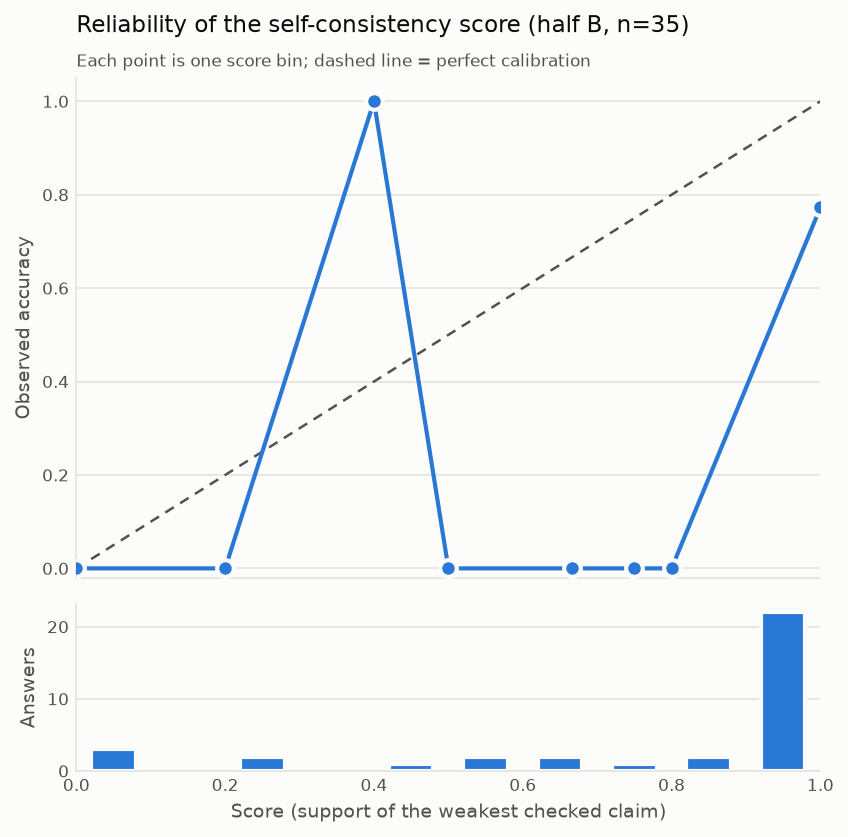

# Self-consistency signal: validation report

Generated 2026-11-24T21:28+00:00 by `apps/api/scripts/validate.py`.

## Key findings

1. **The score ranks answers well but is poorly calibrated.** On half B, AUROC is 0.82 (95% CI 0.69-0.94), but ECE is 0.31. The score is overconfident: 22 of 35 held-out answers scored 1.00, but only 17 of them (77%) were correct. An answer the model gives the same way every time looks consistent even when it is wrong; this is a known limitation of self-consistency. Without the 4 review items: AUROC 0.83 (95% CI 0.68-0.95), ECE 0.25.
2. **Isotonic calibration lowers ECE (0.31 to 0.19) but does not improve Brier (0.25 to 0.26), so it is not applied.** The fit uses only 36 answers from half A.
3. **Refusals are abstained, not scored.** 23 answers abstained with no score; 0 of them were committed answers that should have been scored. 1 declined answer(s) still got a score: `nq-1536`.
4. **Threshold tuning on half A is reported but not applied.** It gives high >= 0.80, medium >= 0.80 (tuned on half A (n=36); no threshold reached 90% precision, so high = max(medium, 0.80)). The tuned high and medium thresholds are equal, so tuning leaves no medium band. Every level in this report uses the configured thresholds, high >= 0.80 and medium >= 0.60.

## Run

- Questions evaluated: **100 of 100**
- Signal versions: `selfconsistency-v2:claude-haiku-5-5` (100)
- Labels: {'correct': 45, 'incorrect': 31, 'not_attempted': 24}; label source: {'exact': 35, 'judge': 65}
- By source: nq_open/correct: 41, nq_open/incorrect: 12, nq_open/not_attempted: 7, simpleqa/correct: 4, simpleqa/incorrect: 19, simpleqa/not_attempted: 17

## Labels needing human review

Their automatic labels are kept (not relabelled). They are kept out of the study set, and the metrics below are shown both with them and without them.

| Item | Auto label | Signal | Note |
|---|---|---|---|
| `simpleqa-2564` | incorrect (judge) | medium, 0.75 | possible gold-label error, needs human check: the answer dates the Priority Enforcement Program to November 2014, while the gold answer (July 2009) may refer to Secure Communities; the question combines both programs |
| `nq-511` | incorrect (judge) | high, 0.80 | possible gold-label error, needs human check: the answer names Sojourner (Mars Pathfinder, July 1997) as the first rover on Mars; the gold answer (January 2004) is the Spirit/Opportunity landing |
| `nq-3500` | incorrect (judge) | high, 1.00 | possible gold-label error, needs human check: the answer says Army of Northern Virginia, the usual name of Lee's army at Gettysburg; the gold answer is the broader Confederate States Army |
| `simpleqa-3208` | incorrect (judge) | high, 1.00 | possible gold-label error, needs human check: the answer dates the apochromat to Zeiss around 1886; the gold answer is 1868, and sources disagree on the date |

## All items vs. review items excluded

Same seeded split; the right column drops the 4 items listed above from both halves. The other sections use all items.

| Metric | All items | Review items excluded |
|---|---|---|
| Usable answers (half A / half B) | 71 (36 / 35) | 67 (35 / 32) |
| AUROC, 95% bootstrap CI (half B) | 0.82 (95% CI 0.69-0.94) | 0.83 (95% CI 0.68-0.95) |
| ECE, 10 bins (half B) | 0.305 | 0.254 |
| Brier (half B) | 0.248 | 0.202 |
| ECE / Brier after isotonic fit | 0.191 / 0.265 | 0.157 / 0.241 |
| Area under risk-coverage curve | 0.263 | 0.215 |
| Tuned thresholds (not applied) | 0.80 / 0.80 | 0.80 / 0.80 |
| High accuracy, all evaluated answers | 0.76 (42/55) | 0.81 (42/52) |
| Low accuracy, all evaluated answers | 0.18 (2/11) | 0.18 (2/11) |

## Exclusions from score-based metrics

29 of 100 excluded:

- answer not_attempted (no committed answer to grade): 24
- no score: signal was insufficient_evidence: 5

## Held-out metrics (half B)

Seeded 50/50 split (seed 20261125) of the 71 usable answers: half A = 36 (threshold tuning, isotonic fit), half B = 35 (reported).

| Metric | Value |
|---|---|
| Accuracy of the answers (half B) | 0.51 |
| AUROC (score vs. correct), 95% bootstrap CI | 0.822 (0.69-0.94) |
| ECE, 10 bins (raw score) | 0.305 |
| Brier (raw score) | 0.248 |
| ECE / Brier after isotonic fit on half A | 0.191 / 0.265 |
| Area under risk-coverage curve (lower is better) | 0.263 |

Levels use the configured thresholds, high >= 0.80 and medium >= 0.60. Tuning on half A gives 0.80 / 0.80 (tuned on half A (n=36); no threshold reached 90% precision, so high = max(medium, 0.80)); that result is reported, not applied.

### Level x correctness, half B, configured thresholds (0.80 / 0.60)

| Level | n | Correct | Incorrect | Not graded | Accuracy | 95% CI (Wilson) |
|---|---|---|---|---|---|---|
| high | 24 | 17 | 7 | 0 | 0.71 | 0.51-0.85 |
| medium | 3 | 0 | 3 | 0 | 0.00 | 0.00-0.56 |
| low | 8 | 1 | 7 | 0 | 0.12 | 0.02-0.47 |

### Risk-coverage (half B)

| Score threshold | Coverage | Risk (error rate among covered) |
|---|---|---|
| >= 1.00 | 0.63 | 0.23 |
| >= 0.80 | 0.69 | 0.29 |
| >= 0.75 | 0.71 | 0.32 |
| >= 0.67 | 0.77 | 0.37 |
| >= 0.50 | 0.83 | 0.41 |
| >= 0.40 | 0.86 | 0.40 |
| >= 0.20 | 0.91 | 0.44 |
| >= 0.00 | 1.00 | 0.49 |

### Reliability diagram (half B)

| Score bin | Answers | Mean score | Observed accuracy |
|---|---|---|---|
| 0.0-0.1 | 3 | 0.00 | 0.00 |
| 0.2-0.3 | 2 | 0.20 | 0.00 |
| 0.4-0.5 | 1 | 0.40 | 1.00 |
| 0.5-0.6 | 2 | 0.50 | 0.00 |
| 0.6-0.7 | 2 | 0.67 | 0.00 |
| 0.7-0.8 | 1 | 0.75 | 0.00 |
| 0.8-0.9 | 2 | 0.80 | 0.00 |
| 0.9-1.0 | 22 | 1.00 | 0.77 |

## Production levels (0.80 / 0.60), all evaluated answers

| Level | n | Correct | Incorrect | Not graded | Accuracy | 95% CI (Wilson) |
|---|---|---|---|---|---|---|
| high | 55 | 42 | 13 | 0 | 0.76 | 0.64-0.86 |
| medium | 5 | 1 | 4 | 0 | 0.20 | 0.04-0.62 |
| low | 12 | 2 | 9 | 1 | 0.18 | 0.05-0.48 |
| insufficient_evidence | 5 | 0 | 5 | 0 | 0.00 | 0.00-0.43 |
| abstained | 23 | 0 | 0 | 23 | n/a | n/a |

## Latency and cost

- Signal latency: p50 3.8 s, p95 7.0 s (measured with 4 questions in flight).
- Signal cost per answer: $0.0010 (mean; first-party API prices).
- Whole run including answer generation and labelling: $0.1232.

## Study set (`data/questions.json`)

Kept out for human review: `nq-3500`, `nq-511`, `simpleqa-2564`, `simpleqa-3208`.

Written: 21 correct + 9 incorrect real answers with their real signals.
Signal hit rate (high = trust, otherwise check): study set 0.87; expected from the measured quality at a 21/9 mix 0.84; measured on all 72 candidates 0.82.

## Limitations

- **Labels are automatic.** Correctness comes from normalized string matching against the gold answers, with an LLM judge for the rest; neither was checked by a person. A string match can also accept an answer that mentions the gold answer while committing to something else.
- **The same model family answers and checks.** The answers, the five samples, the claim extraction, the consistency judge and the label judge all come from Claude models, so shared blind spots inflate agreement: a confidently wrong fact the model always repeats looks consistent.
- **Unaddressed side claims are not checked.** Claims that fewer than 2 samples mention are excluded from the score, so an answer can be scored on its main claim while its side details go unverified.
- **Gold answers can be stale or incomplete** (NQ-open has known answer gaps); SimpleQA was built to be hard for frontier models, so it supplies most of the incorrect answers.
- **Small sample.** With about 100 questions, every interval above is wide; the thresholds are tuned on about 50 answers.
- **Source approval is pending.** See `SOURCE.md`; these questions may not enter the study or the annotation dataset until an authorized owner approves them.
