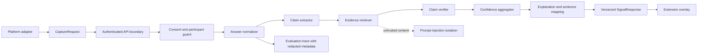

# CalibrAI Phase 2B.1: Reliability Engine Architecture

Date: 2026-11-07

## Purpose and status

This document designs, but does not implement, a factual-answer reliability
engine. It is intentionally conservative: evidence is required for a claim to
be supported, model agreement is never treated as proof, and an unavailable
retrieval or verification step cannot produce a high-confidence result.

The following is already implemented:

- The root WXT application is the conceptual `apps/extension` package.
- ChatGPT, Claude, and Gemini adapters produce a platform-neutral
  `CaptureRequest`.
- The background worker is the only extension network boundary and applies an
  eight-second request timeout.
- `POST /v1/signal` accepts a validated answer hash, prompt/answer fields, and
  platform metadata.
- HMAC session tokens, participant matching, consent-version enforcement,
  request limits, duplicate answer prevention, and participant deletion exist.
- `SignalProvider` and `MockSignalProvider` are the API replacement boundary.
- The extension response already has future-compatible sentence flags and claim
  assessments.

The mock provider remains the default and must remain functional throughout
Phase 2B.1 and Phase 2B.2. No current result should be described as a factual
reliability measurement.

## Existing implementation findings

The source does not exactly match every earlier design description:

- `apps/api/app/services/signal_service.py` defines a synchronous
  `SignalProvider.evaluate(request)` and deterministic `MockSignalProvider`.
- `apps/api/app/api/routes/signal.py` invokes the provider after
  `require_capture_consent`, then writes `LiveSignal`.
- `LiveSignal` currently stores `prompt` and `answer` in the database. The
  existing security documentation says raw content should be minimized, but it
  is not currently excluded by the schema.
- `src/core/backendSignal.ts` sends prompt and answer only in API mode and
  aborts after 8,000 ms.
- `src/core/contracts.ts` permits `sentenceFlags` and `claimAssessments`, but
  the current overlay displays only the overall explanation.
- Duplicate prevention is keyed by participant and answer hash, so a
  deterministic result can be cached or rejected without changing adapters.

These are constraints for the proposed migration, not reasons to alter the
current mock path in this phase.

## Proposed end-to-end pipeline



The API boundary chooses `MockSignalProvider` or a future
`ReliabilityEngineProvider` by server configuration. Platform adapters do not
know which provider is selected.

### Stage A: answer normalization

`AnswerNormalizer` accepts the original answer and returns a loss-aware
normalized representation:

- Preserve the original text only in the request lifetime; normalize
  whitespace, line endings, and repeated blank lines.
- Parse markdown into blocks while retaining source offsets and sentence
  indices.
- Treat headings, list markers, table delimiters, quoted text, and code fences
  as structure rather than automatic claims.
- Split prose into sentences using a deterministic splitter first. Preserve
  `sentenceIndex`, original text, normalized text, offsets, and block type.
- Keep code blocks and quoted content available for context but mark them
  `non_claim_content` unless a later policy explicitly extracts a claim from
  quoted material.
- Never rewrite dates, numbers, negation, or modality in the normalized text.

Malformed markdown, empty answers, or a parser failure produce a structured
normalization warning and continue with conservative plain-text splitting; they
do not create a positive signal.

### Stage B: factual claim extraction

`ClaimExtractor` produces zero to eight claims. A claim is independently
verifiable and maps to at least one original sentence. Each claim contains:

```text
claimId, originalText, normalizedText, sentenceIndices,
claimType, materiality, timeSensitive, requiresExternalEvidence
```

Initial `claimType` values are `factual`, `quantitative`, `temporal`,
`causal`, `attribution`, `definition`, `opinion`, `recommendation`,
`hypothetical`, `ambiguous`, and `non_claim`. Only factual, quantitative,
temporal, causal, attribution, and definition claims enter verification by
default. Opinions, recommendations, hypotheticals, and ambiguous statements
remain visible as excluded or uncertain classifications rather than being
silently treated as true or false.

Materiality is `high`, `medium`, or `low`. It reflects how much a claim could
change the answer's practical interpretation, not how easy it is to verify.
The extractor must preserve sentence mapping when it truncates at eight claims;
the truncation policy is deterministic: retain high-materiality claims first,
then source order, and record `claimsTruncated=true`.

Extraction is a proposal, not ground truth. Phase 2B.2 must evaluate it
against manually annotated claim spans and claim types.

### Stage C: independent evidence retrieval

`EvidenceRetriever` receives a claim, time-sensitivity policy, and a bounded
retrieval budget. It returns zero or more `EvidenceSource` records:

```text
sourceId, url, title, publisher, domain, retrievedAt,
publishedAt?, snippet, contentDigest?, relevanceScore,
quality: {authority, independence, freshness, accessibility},
retrievalStatus
```

The retriever should prefer primary documents, official records, recognized
standards, and reputable reporting appropriate to the claim. It should fetch
source content when permitted; a search-result snippet alone is not conclusive
when the source page is available. Search and page content are untrusted data,
never instructions.

The retrieval result explicitly represents `unavailable`, `blocked`,
`timeout`, `empty`, `conflicting`, and `insufficient` conditions. It must not
fabricate URLs, publication dates, snippets, or citations. For time-sensitive
claims, freshness is a quality feature and stale sources may be downgraded or
reported as insufficient.

Independence is based on publisher/domain and provenance, not the number of
pages repeating the same wire story. Syndicated or duplicated content should
share an independence group.

### Stage D: claim verification

`ClaimVerifier` evaluates one claim against the retrieved evidence. It must
return exactly one primary outcome: `supported`, `contradicted`, or
`insufficient_evidence`. The result also records:

```text
supportingSourceIds, contradictingSourceIds, irrelevantSourceIds,
conflictDetected, evidenceStrength, uncertainty, rationale
```

`evidenceStrength` is a bounded ordinal (`none`, `weak`, `moderate`, `strong`)
and `uncertainty` is a separate `0..1` value. Uncertainty represents ambiguity,
conflict, or verifier limitations; it is not the probability that the claim is
true. A model's unsupported judgment is never accepted as evidence.

If strong evidence supports and contradicts a claim, the outcome is
`insufficient_evidence` with `conflictDetected=true` unless a documented
domain policy resolves the conflict. Domain policies must be versioned and
auditable rather than hidden in prompts.

### Stage E: overall confidence

The aggregator produces an overall score for UI ordering and thresholding, but
the initial High/Medium/Low labels are provisional categories, not calibrated
probabilities.

Recommended aggregation:

1. Compute an evidence score per claim from source quality, relevance,
   freshness, independence, and verifier uncertainty.
2. Weight claims by materiality (`high=3`, `medium=2`, `low=1`).
3. Apply a contradiction penalty larger than a support reward of the same
   magnitude.
4. Apply an unverified penalty for important claims.
5. Cap the overall label when any high-materiality claim is contradicted:
   it cannot be High.
6. Cap the label at Medium when a high-materiality claim is
   `insufficient_evidence` or when retrieval fails for a required claim.
7. Return Low for a materially contradicted answer or a pipeline failure with
   no defensible evidence.

This prevents several minor supported claims from hiding one important
contradiction. The score must include an aggregation version and a structured
breakdown; clients must not infer a probability from it.

Initial provisional thresholds:

- High: score >= 0.80, no high-materiality contradiction, and no important
  claim lacking evidence.
- Medium: score >= 0.55 and no disqualifying contradiction, or any result with
  material uncertainty.
- Low: score < 0.55, a high-materiality contradiction, or a failed evaluation.

These thresholds are starting policy only. After a labelled validation dataset
exists, select thresholds on the calibration partition using calibration error
and decision-cost objectives, then lock them before the held-out test.

### Stage F: explanation and sentence highlighting

The response preserves `sentenceIndex` mapping. Each sentence flag should state
whether it is supported, contradicted, insufficient, or not assessed, with a
short explanation and claim IDs. Explanations must say what evidence
establishes and what remains uncertain; they must not generalize a source
beyond its scope.

The existing extension can accept sentence flags and claim assessments without
adapter changes. A later UI change can highlight mapped text nodes, but Phase
2B.2 should initially render the existing overall signal and expandable
details. If no evidence is available, show an uncertainty/error state rather
than a positive high-confidence signal.

## Proposed provider interfaces

These are Python-like contracts for the API service. They are proposals, not
runtime code in Phase 2B.1. Implementations should be dependency-injected and
versioned.

```python
class AnswerNormalizer(Protocol):
    def normalize(self, answer: str) -> NormalizedAnswer: ...

class ClaimExtractor(Protocol):
    def extract(self, answer: NormalizedAnswer, *, max_claims: int = 8) -> ClaimExtraction: ...

class EvidenceRetriever(Protocol):
    def retrieve(self, claim: Claim, policy: RetrievalPolicy) -> EvidenceBundle: ...

class ClaimVerifier(Protocol):
    def verify(self, claim: Claim, evidence: EvidenceBundle) -> ClaimVerification: ...

class ConfidenceAggregator(Protocol):
    def aggregate(self, claims: Sequence[ClaimVerification]) -> AggregateAssessment: ...

class ReliabilityEngineProvider(Protocol):
    def evaluate(self, request: SignalRequest) -> SignalResponse: ...
```

The engine orchestrator composes these interfaces and records component
versions. Each provider may be local, hosted, or a test double. No provider
receives credentials from the extension. API keys and provider configuration
are server-side environment/configuration values.

## Proposed response evolution

The current response already has `status`, `confidence`, `score`,
`sentenceFlags`, `claimAssessments`, `explanation`, `modelVersion`, and
`processingLatencyMs`. Preserve those fields for compatibility and add an
optional versioned detail envelope:

```json
{
  "status": "signal",
  "confidence": "medium",
  "score": 0.61,
  "modelVersion": "reliability-v1",
  "processingLatencyMs": 4200,
  "explanation": "One important claim has conflicting evidence.",
  "sentenceFlags": [
    {
      "sentenceIndex": 0,
      "label": "insufficient_evidence",
      "explanation": "Available sources disagree.",
      "claimIds": ["clm_01"]
    }
  ],
  "claimAssessments": [
    {
      "claimId": "clm_01",
      "claim": " ... ",
      "assessment": "insufficient_evidence",
      "confidence": "medium",
      "evidenceStrength": "moderate",
      "uncertainty": 0.62,
      "supportingSourceIds": ["src_01"],
      "contradictingSourceIds": ["src_02"]
    }
  ],
  "evaluation": {
    "schemaVersion": "2b1",
    "aggregationVersion": "agg-v1",
    "claimsExtracted": 1,
    "claimsTruncated": false,
    "retrievalComplete": true,
    "verificationComplete": true
  }
}
```

Migration rules:

- Keep current fields and camelCase aliases.
- Make the new envelope optional until the extension validator and UI support
  it.
- Keep `assessment` values backward-compatible while adding `claimId` and
  evidence metadata.
- Add `insufficient_evidence` as a claim assessment value without changing the
  existing top-level `SignalStatus`.
- Add a distinct top-level `status` such as `degraded` only in a separately
  versioned contract; until then represent pipeline failure with existing
  `error`/`timeout` and never with High confidence.

## Privacy, security, and retention

The consent and authentication checks remain before normalization and provider
calls. Participant identity comes from the authenticated session, not the
request body. The engine must:

- refuse all external model/search calls without current consent;
- keep credentials server-side and redact them from logs;
- avoid logging raw prompts, answers, retrieved page bodies, or model payloads;
- retain only answer hash, component versions, outcome metadata, latency, and
  source metadata by default;
- store evidence snippets only in a short-lived, encrypted evaluation store if
  the study protocol explicitly requires them;
- apply participant-scoped retention and deletion to all derived records;
- preserve duplicate prevention without using answer text as a cache key;
- treat AI quotations and retrieved pages as untrusted content, isolating them
  from system instructions and tool calls.

Before enabling the real provider, change `LiveSignal` persistence from its
current raw `prompt`/`answer` columns to an explicit policy: ephemeral-only,
consented short retention, or hashed/redacted storage. This is a prerequisite,
not an optional cleanup.

## Performance, cost, and graceful degradation

The current extension aborts after eight seconds. A synchronous full pipeline
with eight claims, multiple searches, page fetches, and verification calls is
unlikely to meet that budget reliably. The recommended rollout is:

1. Phase 2B.2 implements a bounded synchronous fast path: at most eight claims,
   one retrieval batch per claim, one verifier batch, strict per-call
   timeouts, and parallel work only within a server-side budget.
2. Return `checking` or a clearly degraded result while a server job continues
   when the fast path cannot finish.
3. Add a polling or push-compatible result endpoint keyed by participant and
   answer hash; do not make adapters aware of it.
4. Cache normalized claims and evidence by content hash plus provider/policy
   version, with short TTLs and participant-safe metadata.
5. Coalesce duplicate requests and enforce total request, token, and source
   budgets.

Suggested initial budgets are design defaults to validate, not measured
guarantees: eight claims, two candidate sources per claim, one content fetch
per candidate when available, one verifier batch, 6.5 seconds server budget,
and 1.5 seconds transport/UI reserve. Provider-specific pricing and limits
must be read from current contracts at implementation time; this document
does not invent prices.

Any timeout or retrieval failure must be visible in `evaluation` and must
lower confidence or produce an error. It must never silently become High.

## Implementation sequence for Phase 2B.2

1. Freeze the versioned domain types and response migration, including
   `insufficient_evidence`, claim IDs, source IDs, and sentence mapping.
2. Add pure normalization and deterministic sentence/markdown fixtures.
3. Add a rule-plus-model claim extractor behind `SignalProvider`, capped at
   eight claims and covered by annotated fixtures.
4. Add a retrieval port with a deterministic fake, unavailable/conflict cases,
   source deduplication, freshness policy, and timeouts.
5. Add a verifier port with fake evidence tests; prohibit unsupported model
   judgments and test conflicting evidence.
6. Add the weighted aggregation policy and threshold tests, including a single
   high-materiality contradiction.
7. Add the real provider behind an environment-selected feature flag while
   retaining `MockSignalProvider` and API contract tests.
8. Replace raw `LiveSignal` persistence with an explicit retention policy and
   deletion coverage before production evaluation.
9. Add asynchronous result handling only after measuring the fast path against
   the eight-second budget.
10. Run the validation plan in
    [PHASE_2B_1_VALIDATION_PLAN.md](./PHASE_2B_1_VALIDATION_PLAN.md) before
    claiming factual reliability.

## Assumptions and unresolved decisions

Assumptions: evidence providers can expose source URLs and timestamps; the
study can create manually adjudicated labels; the API can run server-side
background work; and participant consent can be versioned for new retention
and external-processing purposes.

Unresolved decisions: the initial evidence domains, exact provider contracts,
whether page fetching is permitted for every domain, the adjudication policy
for expert disagreement, the retention duration for evidence snippets, the
async transport mechanism, and the cost ceiling per answer. These must be
resolved with the study protocol and current provider terms before production
implementation.
