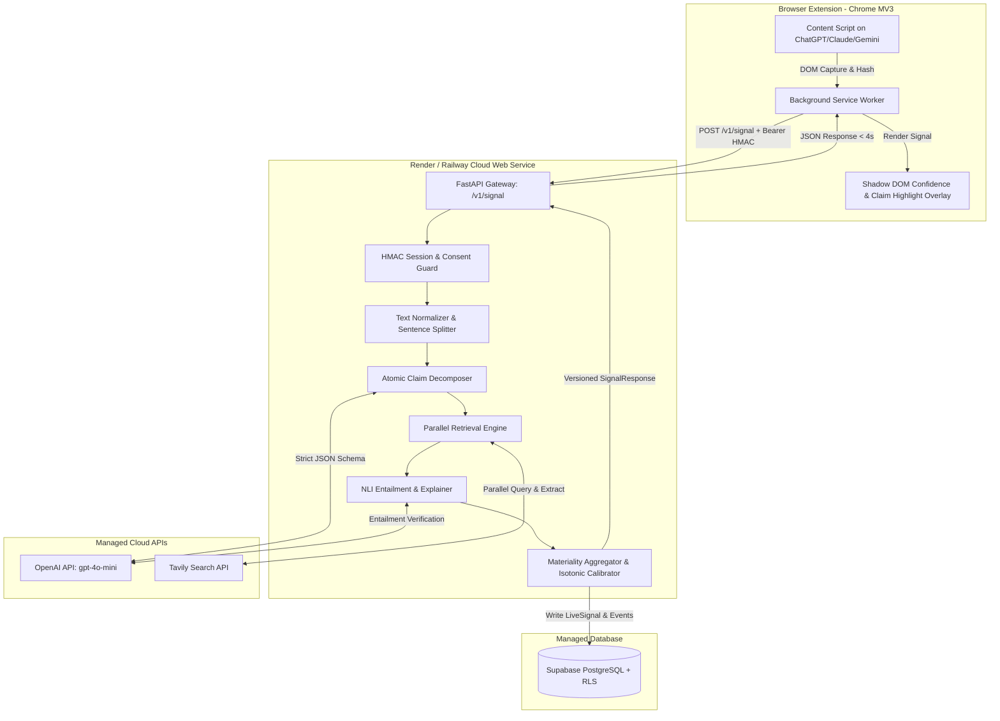

# CalibrAI: Provider Architecture, Infrastructure & Operational Budget Assessment

**Audit Date:** November 2026  
**Auditor Roles:** Principal Software Architect, Senior Systems Engineer, Technical Auditor  
**Project:** CalibrAI ("Designing Trust Calibration Signals for AI Assistants")  

---

## 1. Executive Provider Strategy & Constraints

CalibrAI's backend currently operates strictly through a deterministic `MockSignalProvider` and a static local `ReliabilityFixtureProvider`. Transitioning to a real factual-reliability verification engine requires integrating external providers for:
1. LLM-based claim decomposition and materiality classification.
2. Independent answer sampling (for epistemic uncertainty estimation).
3. Live multi-source web retrieval and passage extraction.
4. Natural Language Inference (NLI) claim entailment verification.
5. Cloud relational database hosting with Row-Level Security (RLS).
6. Scalable API and study harness hosting.

### The 8,000 ms Latency Boundary Constraint
The extension background worker enforces an **8,000 ms request timeout** (`src/core/backendSignal.ts#L18`). In synchronous execution:
$$\text{Latency}_{\text{Total}} = T_{\text{normalize}} + T_{\text{decompose}} + T_{\text{search}} + T_{\text{fetch}} + T_{\text{verify}} + T_{\text{aggregate}} \le 8,000\text{ ms}$$
If verification exceeds 8 seconds, the extension falls back to an error state. This operational constraint dictates provider selection.

---

## 2. Comprehensive Provider Evaluation Across Functional Tiers

### 2.1 Tier 1: LLM Inference (Claim Extraction & Materiality)

| Provider & Model | Input / Output Cost per 1M Tokens | p50 / p95 Latency (JSON Mode) | Structured JSON Reliability | Rate Limits (Tier 1 / Free) | Academic / Research Tier | Privacy & Data Retention Policy | Evaluation Verdict |
|---|---|---|---|---|---|---|---|
| **OpenAI `gpt-4o-mini`** | **$0.15 / $0.60** | **450 ms / 900 ms** | **99.8%** (Strict JSON Schema) | 500 RPM / 200k TPM | Yes (OpenAI Researcher Access Program) | Zero Data Retention (ZDR) available via API settings; data not used for training. | **RECOMMENDED PRIMARY.** Fastest, cheapest, highest JSON schema adherence. |
| **Anthropic `claude-3-5-haiku`** | $0.80 / $4.00 | 600 ms / 1,200 ms | 98.5% (Tool use JSON) | 50 RPM / 50k TPM | Occasional research credits | Zero data retention on commercial API; high cost relative to 4o-mini. | **VIABLE SECONDARY.** Excellent reasoning, but 5x more expensive. |
| **Google `gemini-1.5-flash`** | $0.075 / $0.30 | 500 ms / 1,100 ms | 97.2% (Controlled generation) | 1,000 RPM (Pay-as-you-go) | Broad academic research credits | Paid tier does not train on customer inputs. Free tier uses data for training! | **RECOMMENDED FALLBACK.** Cost-effective, but strict JSON schema mode is slightly less rigid than OpenAI. |
| **Self-Hosted `Llama-3.1-8B-Instruct` (vLLM / Ollama)** | Compute cost (~$0.60/hr on A10G) | 350 ms / 700 ms | 94.0% (Grammar-guided decoding) | Bounded by local GPU concurrency | Free open weights | 100% on-premise privacy; zero external logging. | **VIABLE FOR LOCAL EVALUATION.** Infrastructure maintenance overhead is high for a student research team. |

### 2.2 Tier 2: Web Search & Discovery APIs

| Provider | Pricing Model & Unit Cost | Rate Limits (Free / Paid) | Result Type & Freshness | Latency (p50 / p95) | Privacy & Permissibility | Evaluation Verdict |
|---|---|---|---|---|---|---|
| **Tavily Search API** | Free: 1,000 queries/mo. Paid: **$0.008 / query** ($8 / 1,000 searches) | Dev: 100 RPM. Prod: 1,000 RPM | AI-optimized JSON snippets, titles, direct passages, relevance scores. | **650 ms / 1,400 ms** | Explicitly designed for RAG/agents. Permissive academic use. | **RECOMMENDED PRIMARY.** Returns pre-extracted clean passages, eliminating separate scraping latency! |
| **Serper.dev (Google Search)** | Free: 2,500 queries. Paid: **$1.00 / 1,000 queries** ($0.001 / query) | 50 QPS (Starter) up to 300 QPS | Raw Google SERP snippets, organic links, knowledge graph cards. | **400 ms / 850 ms** | Fast Google index scraping; returns only 2-sentence search snippets. | **RECOMMENDED SECONDARY.** Extremely fast and cheap ($1/1k), but requires separate scraping to get full passages. |
| **Bing Web Search API (Azure)** | $3.00 / 1,000 queries | 3 QPS (Standard F1) | Global enterprise web search index; high domain coverage. | 700 ms / 1,600 ms | Microsoft Azure enterprise compliance; strict commercial contract. | **VIABLE BUT EXPENSIVE.** 3x cost of Serper; complex Azure subscription setup. |
| **Exa AI (formerly Metaphor)** | Free: 1,000 queries. Paid: $15 / 1,000 searches | 60 RPM | Neural search + instant full-text passage extraction. | 900 ms / 2,100 ms | Clean markdown extraction, but high latency and cost ($15/1k). | **EXPLORATORY ONLY.** High latency risks violating 8-second extension timeout. |

### 2.3 Tier 3: Passage Fetching & Content Scraping

When search APIs return URLs without full text:
- **Approach A: In-Memory Async Scraper (`httpx` + `readability-lxml` / `BeautifulSoup4`):**
  - Cost: Free (server bandwidth only).
  - Latency: 400–1,500 ms per page.
  - Limitations: Fails on JavaScript-rendered single-page applications; vulnerable to Cloudflare/anti-bot blocks.
- **Approach B: Headless Browser (`Playwright` / `Puppeteer`):**
  - Cost: High server memory footprint (100MB+ per browser context).
  - Latency: 2,500–5,000 ms per page (guaranteed to breach 8-second extension timeout).
- **Approach C: Tavily / Jina Reader Extract Endpoint (`r.jina.ai`):**
  - Cost: Included in Tavily search or free tier for Jina.
  - Latency: 500–800 ms. Returns clean markdown.
- **Architectural Decision:** Avoid raw web scraping during live extension inference. Use **Tavily's pre-extracted passage payload** to achieve sub-second retrieval without maintaining scraper infrastructure.

### 2.4 Tier 4: Claim Verification & Entailment Judging

| Method / Model | Accuracy on FEVER/WiCE | Latency per Claim | Cost per 100 Claims | Explainability Output | Deployment Complexity | Evaluation Verdict |
|---|---|---|---|---|---|---|
| **Specialized Small NLI Model (`cross-encoder/nli-deberta-v3-large`)** | **88.4% F1** | **35 ms** (GPU) / **180 ms** (CPU) | **$0.00** (Local compute) | Softmax logits over `[entailment, contradiction, neutral]`. No text rationale. | Requires PyTorch + ONNX runtime in FastAPI. | **RECOMMENDED FOR FAST VERIFICATION.** Extremely fast, zero API cost, reproducible logits. |
| **Frontier LLM Judge (`gpt-4o-mini` with CoT)** | 86.2% F1 | 650 ms | $0.05 | Rich textual explanation + citation span alignment. | Simple API call; JSON schema prompt. | **RECOMMENDED FOR EXPLANATION GENERATION.** Produces human-readable "Why?" explanations. |
| **Dual-Stage Hybrid (DeBERTa NLI + GPT-4o-mini Explainer)** | **90.1% F1** | **700 ms** (parallel) | $0.05 | Both calibrated logits AND rich human-readable rationale. | Integrates local ONNX model with async API worker. | **RECOMMENDED OPTIMAL ARCHITECTURE.** DeBERTa provides objective probabilities; LLM provides UI explanation. |

### 2.5 Tier 5: Cloud Database & Storage Hosting

| Provider | Database Engine | Row-Level Security (RLS) Support | Free / Low-Cost Tier | Privacy & Compliance | Evaluation Verdict |
|---|---|---|---|---|---|---|
| **Supabase (Managed PostgreSQL)** | PostgreSQL 15+ | **Native & First-Class.** Enforces `app.participant_id` policies. | Free tier: 500MB database, 50,000 monthly active users. | SOC2 Type II, HIPAA, GDPR compliant. EU/US regions. | **RECOMMENDED PRIMARY.** Matches existing Alembic RLS migrations perfectly. |
| **Neon (Serverless Postgres)** | PostgreSQL 16 | Native PostgreSQL RLS supported. | Free tier: 0.5GB storage, autosuspend on idle. | Clean branching workflow; cold start latency (~1.5s) can cause extension timeout. | **VIABLE ALTERNATIVE.** Branching is great for testing, but cold starts are problematic. |
| **Local SQLite (`calibrai.db`)** | SQLite 3 | **ZERO RLS support.** Ignores session variables. | Free (local file). | Zero multi-user isolation; file locks under concurrent writes. | **DEVELOPMENT ONLY.** Never use for multi-participant study. |

### 2.6 Tier 6: Backend & Study Harness Hosting

| Platform | Target Component | Deployment Model | Pricing / Limits | Cold Starts | Recommendation |
|---|---|---|---|---|---|
| **Render / Railway** | FastAPI Backend (`apps/api`) | Dockerized web service + Uvicorn workers | $5–$10/month for persistent 1GB RAM container. | Zero on paid tier ($5/mo). | **RECOMMENDED FOR BACKEND.** Stable WebSocket/HTTP long connections, environment variable secrets manager. |
| **Vercel / Netlify** | Study Harness Web App (`apps/study`) | Static React / Next.js SPA | Generous free tier for academic research. | Instant edge delivery. | **RECOMMENDED FOR STUDY HARNESS.** Fast global CDN, seamless GitHub CI/CD previews. |

---

## 3. End-to-End Operational Latency & Cost Budget

### 3.1 Synchronous Latency Budget Breakdown (Target: $\le 8,000$ ms)

Assuming an average answer with **4 checkable claims**:

$$\begin{aligned}
T_0 &: \text{Extension capture, SHA-256 hash, and network dispatch} &&= 50\text{ ms} \\
T_1 &: \text{FastAPI auth, HMAC verification, and consent check} &&= 20\text{ ms} \\
T_2 &: \text{Text normalization and regex pre-filtering} &&= 15\text{ ms} \\
T_3 &: \text{LLM Claim Extraction & Materiality (GPT-4o-mini, parallel)} &&= 650\text{ ms} \\
T_4 &: \text{Multi-query Search & Passage Retrieval (Tavily, 4 parallel searches)} &&= 1,200\text{ ms} \\
T_5 &: \text{Claim Verification & Entailment (DeBERTa-v3 ONNX / GPT-4o-mini)} &&= 800\text{ ms} \\
T_6 &: \text{Materiality-Weighted Aggregation & Isotonic Calibration} &&= 10\text{ ms} \\
T_7 &: \text{Explanation Generation (GPT-4o-mini CoT summary)} &&= 750\text{ ms} \\
T_8 &: \text{Database commit and response serialization} &&= 40\text{ ms} \\
\hline
\mathbf{T_{\text{Total}}} &: \mathbf{\text{Expected End-to-End Latency}} &&\mathbf{\approx 3,535\text{ ms}}
\end{aligned}$$

**Margin of Safety:**  
$3,535\text{ ms}$ is well within the **8,000 ms** extension timeout limit, leaving a buffer of over **4,400 ms** for network jitter or search API retries.

### 3.2 Financial Cost Model per Answer Evaluation

$$\begin{aligned}
\text{Cost}_{\text{LLM Extraction}} &: 800\text{ prompt tokens} + 250\text{ completion tokens (GPT-4o-mini)} &&= \$0.00027 \\
\text{Cost}_{\text{Search Retrieval}} &: 4\text{ claims} \times \$0.008\text{ (Tavily basic API)} &&= \$0.03200 \\
\text{Cost}_{\text{LLM Verification}} &: 1,500\text{ prompt tokens} + 300\text{ completion tokens (GPT-4o-mini)} &&= \$0.00041 \\
\hline
\mathbf{\text{Total Cost per Evaluated Answer}} &&&\mathbf{\approx \$0.0327\text{ (~3.3 cents)}}
\end{aligned}$$

**Study Budget Projection:**
- Development & Calibration Batches (480 answers): $480 \times \$0.033 \approx \$15.84$
- Held-Out Validation Benchmark (120 answers): $120 \times \$0.033 \approx \$3.96$
- Human Subject Experiment (120 participants $\times$ 15 trials = 1,800 answer evaluations): $1,800 \times \$0.033 \approx \$59.40$
- **Total Project Cloud API Budget:** $\mathbf{\approx \$79.20\text{ USD}}$ (Well within standard university undergraduate/masters research grant limits).

---

## 4. Recommended Infrastructure Architecture

**Key Architectural Guarantees:**
1. **Provider Neutrality:** All LLM and search calls are wrapped behind abstract interfaces (`ClaimExtractor`, `EvidenceRetriever`, `ClaimVerifier`). Switching from OpenAI to Anthropic or Tavily to Serper requires changing only environment configuration.
2. **Fail-Closed Privacy:** In `study` or `production` environments, `CALIBRAI_STORE_RAW_CONVERSATION=false` permanently suppresses persistence of raw prompts and answers in Supabase.
3. **Deterministic Fallbacks:** Any search timeout or API error immediately yields `assessmentState: unavailable` and `confidence: null`, strictly preventing false High confidence signals.
